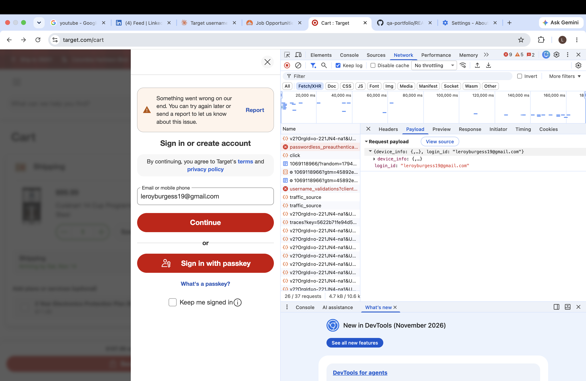

# QA Portfolio — Leroy Burgess

Leroy Burgess is a Software QA Engineer with hands-on experience in manual and regression testing within Agile and Scrum environments. This portfolio showcases end-to-end test planning, test case design, and risk assessment across real-world e-commerce style applications. Currently expanding into automation testing and SQL-driven quality assurance to bring deeper technical rigor to future roles.

**Contact:** leroyburgess19@gmail.com · [LinkedIn](https://www.linkedin.com/in/leroyburgess)

## Structure

Each project lives under `projects/<project-name>/` and contains the test planning artifacts and bug reports produced for that application.

```
projects/
└── target/
    ├── test-plan-and-test-cases.pdf
    ├── test-summary-report.pdf
    └── bug-reports/
        └── bug-001-account-sign-in-failure/
            ├── bug-report.pdf
            ├── screen-recording.mov
            ├── screenshot-1.png
            └── screenshot-2.png
```

Each bug report folder pairs the written report with its supporting evidence (screen recording, screenshots) so the full context is kept together.

## Projects

### Target

Manual QA effort covering the Target.com web application:

- **Test Plan & Test Cases** — scope, risks, assumptions, and environment for validating product search, store selection, cart, and sign-in functionality, plus 10 functional, negative, boundary, and edge-case test cases.
- **Test Summary Report** — execution results (8 passed, 1 failed, 1 blocked) and defect summary from the 48-hour test cycle.
- **Bug Reports** — defects found during scripted testing, each with reproduction steps and supporting evidence.

> Note: video evidence files are excluded from git (see `.gitignore`) to keep the repository lightweight; they remain in place on disk alongside their bug reports.

**BUG-001 — User cannot create an account or log in to an existing account** (High severity/priority): the sign-in flow fails at the email step, blocking account creation and access for all users.


