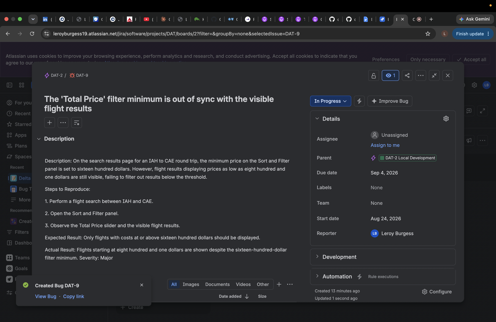

# QA Portfolio — Leroy Burgess

Leroy Burgess is a Software QA Engineer with hands-on experience in manual and regression testing within Agile and Scrum environments. This portfolio showcases end-to-end test planning, test case design, and risk assessment across real-world e-commerce style applications. Currently expanding into automation testing and SQL-driven quality assurance to bring deeper technical rigor to future roles.

**Contact:** leroyburgess19@gmail.com · [LinkedIn](https://www.linkedin.com/in/leroyburgess)

## Structure

Each project lives under `projects/<project-name>/` and contains the test planning artifacts and bug reports produced for that application.

```
projects/
└── delta-airlines/
    ├── test-plan.txt
    ├── test-cases.txt
    └── bug-reports/
        └── bug-001-total-price-filter-out-of-sync/
            ├── bug-report.txt
            ├── screen-recording.mov
            └── screenshot.png
```

Each bug report folder pairs the written report with its supporting evidence (screen recording, screenshots) so the full context is kept together.

## Projects

### Delta Airlines

Manual QA effort covering the Delta Airlines web application:

- **Test Plan** — scope, risks, assumptions, and environment for validating flight search, payment, booking, and SkyMiles/account functionality.
- **Test Cases** — functional and negative test cases spanning round-trip search, booking with payment, passenger limits, SkyMiles login, promo codes, and input validation.
- **Bug Reports** — defects found during exploratory and scripted testing, each with reproduction steps and supporting evidence.

> Note: video and image evidence files are excluded from git (see `.gitignore`) to keep the repository lightweight; they remain in place on disk alongside their bug reports.

**Bug report execution walkthrough video:** https://youtu.be/Ilx0_8gqO5A


